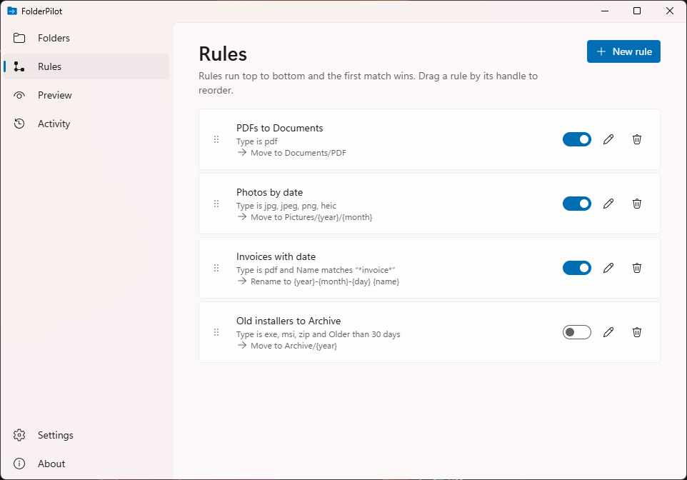
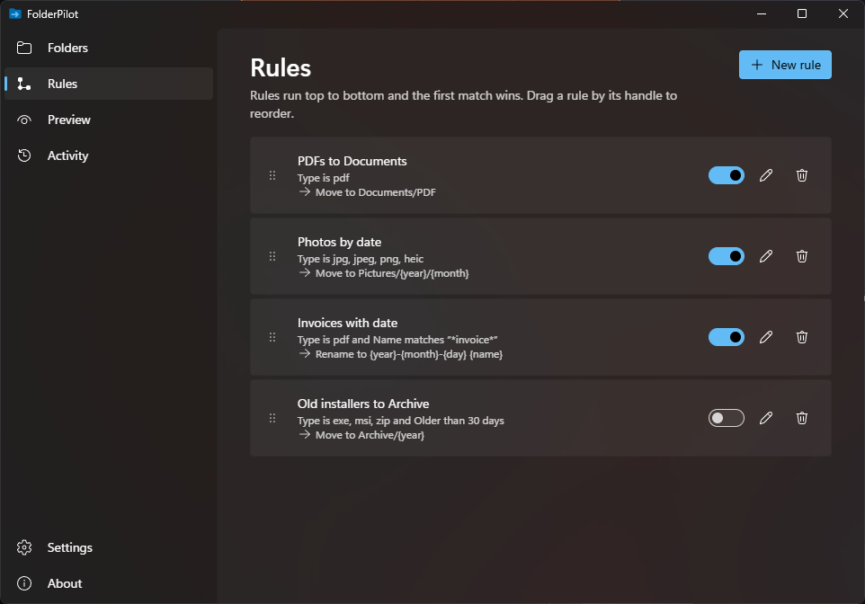

# FolderPilot

Open-source automatic file organiser for Windows. Pick the folders to watch, write a few plain rules, and FolderPilot moves or renames new files for you, from the tray, without admin rights.




In English and Polish (it follows the Windows display language; switch it in **Settings**), light and dark themes.

## Install

Download `FolderPilot_0.2.0_x64-setup.exe` from the [releases](https://github.com/prejas3/FolderPilot/releases) and run it. It installs for your user only (no admin prompt). Closing the window keeps FolderPilot in the tray; **Start with Windows** (in **Settings** or the tray menu) starts it hidden at login. Uninstalling removes the app and that startup entry; your rules and history stay in `%APPDATA%\FolderPilot`.

## Rules

A rule reads as a sentence: *when a file in these folders matches…, move it to… / rename it to…*. Rules run top to bottom and the first one that matches a file wins; drag to reorder.

- **Match by** file type (`pdf, docx`), name pattern (`*invoice*`), age (older than N days, by modified date) and size (bigger / smaller than N MB). All conditions you add must hold.
- **Move to** a folder: `~` is your user folder, a relative path stays inside the watched folder.
- **Rename to** a new name in the same folder; the extension is kept unless you use `{ext}`.
- **Tokens**: `{name}` `{ext}` `{year}` `{month}` `{day}` `{counter}`. For photos the date is when the photo was taken (EXIF), for other files when they were last modified.

The four starters, under **New rule**:

| Starter | When | Then |
|---|---|---|
| PDFs to Documents | type is pdf | move to `~/Documents/PDF` |
| Photos by date | type is jpg, jpeg, png, heic | move to `~/Pictures/{year}/{month}` |
| Rename with date | type is pdf, docx | rename to `{year}-{month}-{day} {name}` |
| Archive files older than 90 days | older than 90 days | move to `D:/Archive/{year}` |

## Safe by design

- **Never deletes, never overwrites.** A name that is taken gets ` (2)`, ` (3)`… When moving to another drive, the file is copied, checked, and only then removed from where it was.
- **Waits for files to settle.** Downloads in progress (`.crdownload`, `.part`, `.tmp`, Office `~$` files) are skipped, and a new file is handled only after it stops changing and no other program has it open.
- **Preview first.** New rules start switched off; **Preview** shows every planned move before anything happens.
- **Undo.** Every move is logged; **Activity** lists each run with an **Undo** button. Undo skips a file that has changed or gone since it was moved, and never overwrites what is back in its old place.
- **Pause** everything from **Settings** or the tray, or one folder from **Folders**.

## Develop

```sh
npm install
npm run tauri dev
cargo test --manifest-path src-tauri/Cargo.toml
npm run check:i18n    # every string in English and Polish, no hard-coded text
npm run tauri build   # NSIS installer in src-tauri/target/release/bundle/nsis
```

Tests only touch temporary folders.

## Licence

MIT, see [LICENSE](LICENSE). Third-party components: [THIRD_PARTY.md](THIRD_PARTY.md); their licence texts ship in `THIRD_PARTY_LICENSES.txt` (`npm run notices` rebuilds it).
